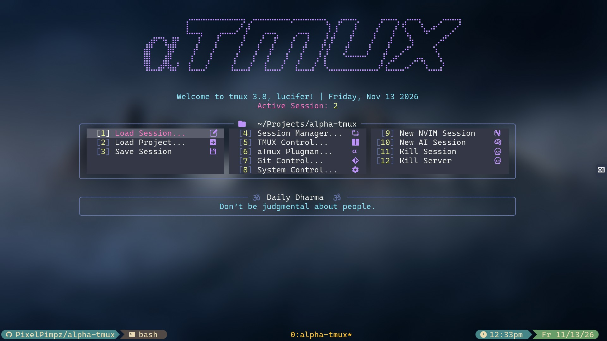
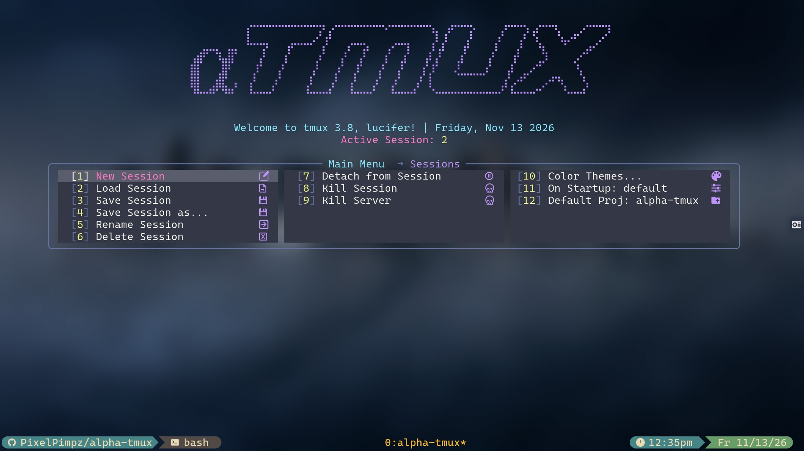
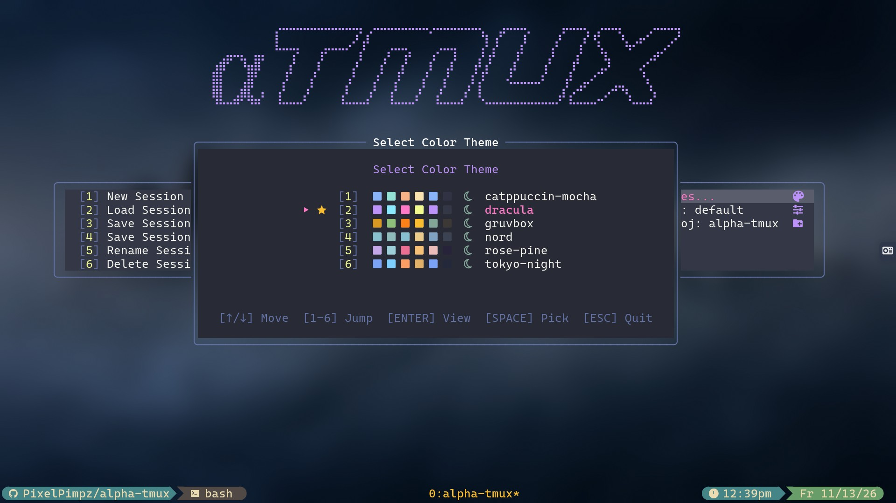
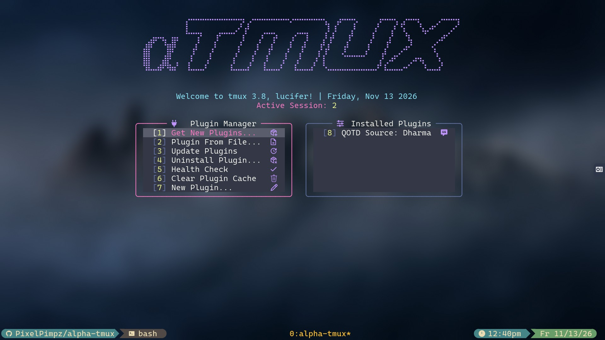

# alpha-tmux

A modular, keyboard-driven TUI command center and launcher for **tmux**, written in pure Bash and driven by YAML.



## Screenshots

| Session Manager | Theme Switcher | Plugin Manager (`aTmux Plugman`) |
| :---: | :---: | :---: |
|  |  |  |

## Features

- **YAML-Driven Multi-Column Menus** — Navigate with arrow keys, Vim keys (`h`/`j`/`k`/`l`), `Tab`, or number keys (`1`–`9`, `10+`), with live breadcrumb trails and an ANSI braille banner.
- **Session Blueprints** — Save, load, rename, and delete full tmux session layouts (windows, pane paths, layouts, and running commands) stored as YAML blueprints.
- **Project Switcher** — Jump straight into any project directory as a new tmux window or dedicated session.
- **Git Control** — Commit and push the current repository or batch-sync all dirty repositories in your projects folder (with automatic TPM plugin reload).
- **Theme Engine** — Instant theme switching with cached 24-bit ANSI highlights across 6 built-in themes:
  - `catppuccin-mocha`, `dracula`, `gruvbox`, `nord`, `rose-pine`, `tokyo-night`
- **Plugin Manager (`aTmux Plugman`)** — Dual-pane plugin manager backed by `config/catalog.yaml`:
  - Browse and install plugins from the catalog (`Get New Plugins...`)
  - Sync & update installed plugins (`Update Plugins`)
  - Uninstall plugins with confirmation (`Uninstall Plugin...`)
  - Configure plugin options in-place (includes bundled `qotd` Daily Wisdom plugin)
- **TMUX & System Control** — Reload config, update TPM plugins, and run system actions (`logout`, `reboot`, `poweroff`, etc.).

---

## Requirements

- **tmux**
- **Bash 4.3+** (uses namerefs `local -n` and associative arrays)
- **[yq](https://github.com/mikefarah/yq)** (v4+)
- **[ascii-image-converter](https://github.com/TheZoraiz/ascii-image-converter)** (for the braille header banner)
- **git**
- **A [Nerd Font](https://www.nerdfonts.com/)** (for menu and status icons)
- *Optional*: `pv` (live elapsed timer during plugin installs/updates), `fzf` (Nerd Font picker)

---

## Installation (TPM)

Add `alpha-tmux` to your `tmux.conf`:

```tmux
set -g @plugin 'PixelPimpz/alpha-tmux'
```

Reload tmux and press `prefix + I` to install via TPM.

### Usage

Press **`prefix + c`** inside tmux to launch **Alpha-Tmux** in a new window (or run `./run` directly).

| Key | Action |
| --- | --- |
| `↑` `↓` `←` `→` / `h` `j` `k` `l` / `Tab` | Navigate grid |
| `Enter` / `Space` / `1`–`9` | Activate selected button |
| `Esc` | Go back / cancel mode |
| `q` | Quit to shell |

---

## Project Structure

```text
alpha-tmux/
├── alpha-tmux.tmux        # TPM entrypoint & keybindings
├── run                    # Symlink to scripts/io-loop.sh
├── config/
│   ├── catalog.yaml       # Installed & available plugin catalog
│   ├── icons.yaml         # Nerd Font glyph registry
│   ├── settings.yaml      # User profiles & active preferences
│   └── menus/             # YAML definitions for all TUI screens
├── plugins/               # Installed plugins (qotd bundled)
├── scripts/
│   ├── io-loop.sh         # Main event loop
│   ├── actions/           # Menu actions (plugman, sessions, git, themes, etc.)
│   ├── hooks/             # tmux hooks (session-created)
│   ├── ui/                # Header, breadcrumbs, and menu grid renderer
│   └── utils/             # yqtools, colorizer, boxer, navigator, plugtools, popups
└── themes/                # Built-in color themes
```

---

## Writing a Plugin

Plugins live in `plugins/<name>/` and need two files:

1. **`plugin.yaml`**
   ```yaml
   name: "my-plugin"
   title: "My Plugin"
   icon: "plug"
   enabled: "ON"
   unit: "pre-foot"
   only_main: 1
   start: "init.sh"
   draw: "my_plugin_draw"
   ```
2. **`init.sh`**
   ```bash
   #!/usr/bin/env bash
   [[ -n "$_ALPHA_MY_PLUGIN_SH" ]] && return 0
   _ALPHA_MY_PLUGIN_SH=1

   my_plugin_draw() {
     center "${ACCENTC}$(get_icon "plug")  ${TEXTC}Hello from My Plugin!${RESET}"
   }
   ```

Any plugin repository on GitHub can also be added directly under `installed:` in `config/catalog.yaml` (`name`, `title`, `icon`, `repo`, `desc`) and synced with **Update Plugins**.
